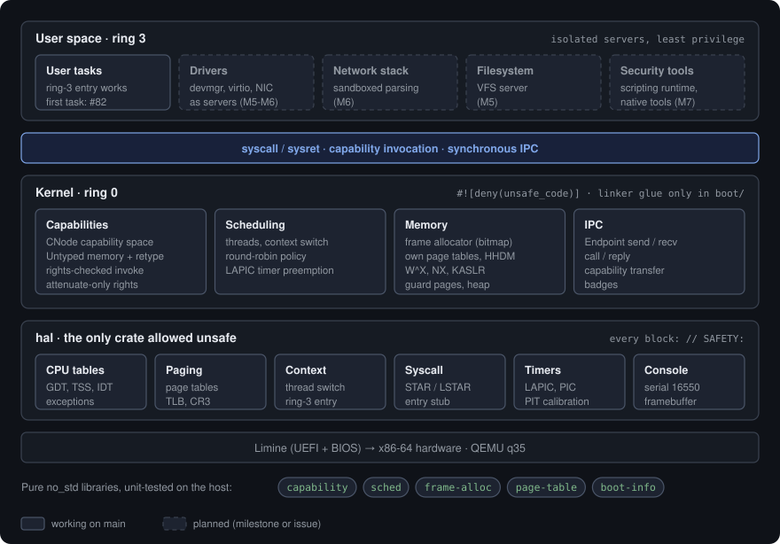
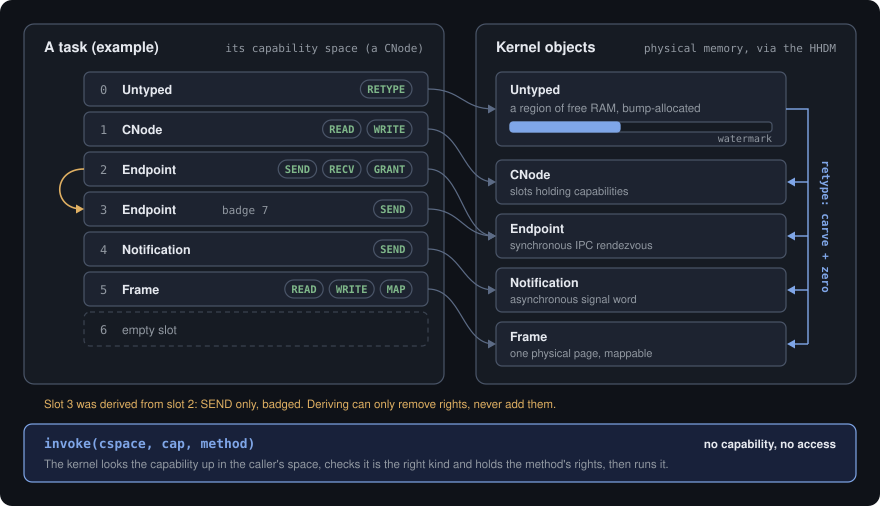
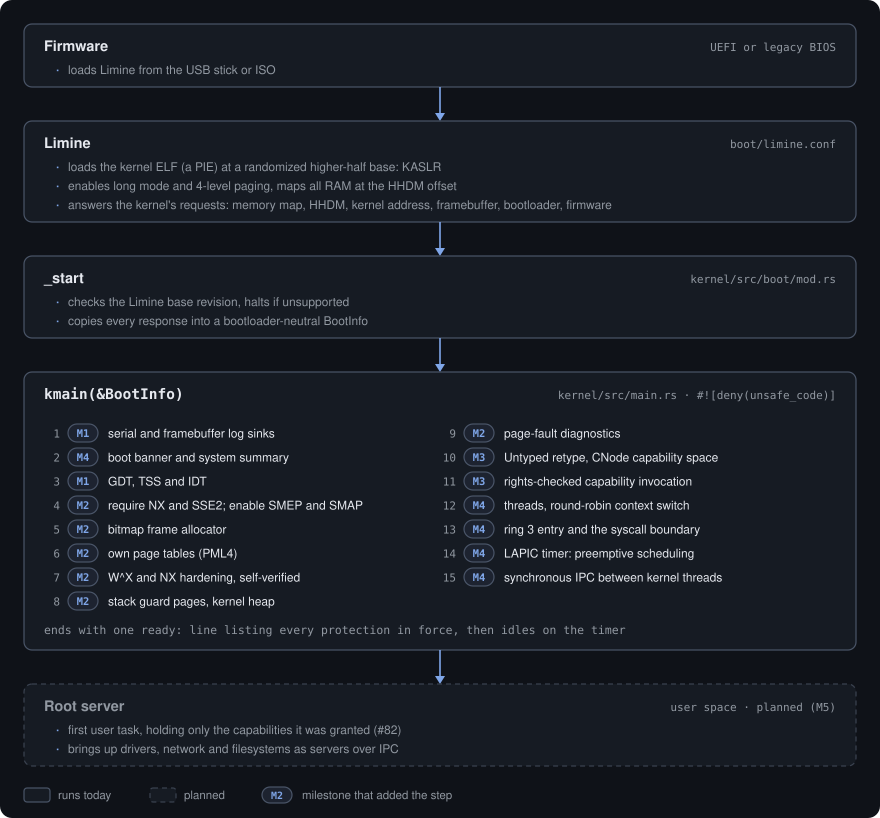
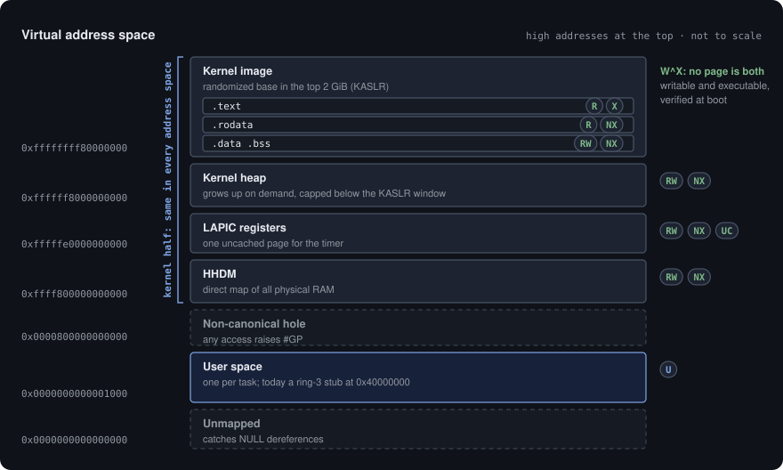

<div align="center">

<picture>
  <source media="(prefers-color-scheme: dark)" srcset="docs/assets/brand/banner-dark.svg">
  
</picture>

**A hardened, capability-based x86-64 microkernel, written from scratch in Rust.**

[](https://github.com/seedon198/magnetite/actions/workflows/ci.yml)
[](https://github.com/seedon198/magnetite/releases)
[](LICENSE)


[Documentation](docs/README.md) ·
[Architecture](docs/architecture/overview.md) ·
[Roadmap](docs/roadmap.md) ·
[Threat model](docs/architecture/threat-model.md) ·
[Security](SECURITY.md) ·
[Changelog](CHANGELOG.md)

</div>

---

> [!WARNING]
> **Pre-alpha.** Magnetite boots on x86-64 (UEFI and BIOS) in QEMU with its own
> CPU tables, memory management and hardening, a capability model, threads,
> and a ring-3 syscall boundary
> ([v0.3.0](https://github.com/seedon198/magnetite/releases/tag/v0.3.0), with
> M4 under way). IPC, user-space servers and the security tooling are still
> ahead. For authorized security research and testing only.

<p align="center">
  
</p>

## What it is

Magnetite is a clean-slate **microkernel** for x86-64. It is a kernel, not a
full operating system: the privileged core stays as small as possible, and
everything else (drivers, the network stack, filesystems, and eventually the
security tooling) is designed to run as isolated, least-privilege servers in
user space. Two goals drive the design:

1. **Hardened by construction.** Written in Rust, with **no `unsafe` code
   outside one small, audited hardware crate**. Every resource is reached
   through an unforgeable **capability**; there is no ambient authority, so a
   bug in a parser cannot reach the kernel or anything it was not handed.
2. **A foundation for security work.** The long-term aim is a platform that
   *does* security work (raw packet access, sniffing, scanning, fuzzing)
   through native tools and an embedded scripting runtime (milestone M7).

## Highlights

What works on `main` today, verified on every boot in QEMU:

| | |
|---|---|
| **Memory safety** | No `unsafe` outside `hal`, where every block carries a `// SAFETY:` justification, and the kernel's `boot` module, which holds only linker glue. Pure crates `#![forbid(unsafe_code)]`; the kernel `#![deny(unsafe_code)]`; CI-checked ([ADR 0007](docs/adr/0007-unsafe-policy.md)) |
| **Exploit mitigations** | W^X enforced and self-verified, NX on everything including the direct map, SMEP and SMAP, KASLR, unmapped stack guard pages |
| **Capabilities** | CNode-backed capability spaces, Untyped memory and retype (the kernel never heap-allocates objects), attenuate-only rights, rights-checked invocation |
| **Threads** | Context switching, a round-robin scheduler, ring-3 entry and a `syscall`/`sysret` boundary with a message-register ABI |
| **Diagnostics** | Exception register dumps, page-fault classification (guard page, heap, text, direct map), backtraces |
| **Testable core** | Policy lives in pure `no_std` crates (`capability`, `sched`, `frame-alloc`, `page-table`, `boot-info`) that are unit-tested on the host |

## Architecture

<p align="center">
  
</p>

| Area | Choice | Why | ADR |
|---|---|---|---|
| Language | **Rust** (`no_std`) | Memory safety removes whole exploit classes from the kernel | [0001](docs/adr/0001-implementation-language.md) |
| `unsafe` policy | **`forbid(unsafe)`** except an audited `hal` crate | Shrinks the trusted, unsafe surface to an auditable core | [0007](docs/adr/0007-unsafe-policy.md) |
| Kernel model | **Microkernel** | Minimal ring-0 TCB; isolate drivers, network and filesystems in user space | [0004](docs/adr/0004-kernel-architecture.md) |
| Security model | **Capabilities** (least privilege) | No ambient authority; every resource is an unforgeable handle | [0006](docs/adr/0006-security-model.md) |
| Offensive layer | **Native tools + scripting runtime** | Write and run security tooling without rebuilding the system | [0008](docs/adr/0008-native-tooling.md) |
| Toolchain | **Rust + LLVM**, QEMU | Cross-compiles to bare metal from macOS or Linux out of the box | [0002](docs/adr/0002-toolchain.md) |
| Bootloader | **Limine** | Long mode, higher half, UEFI and BIOS, memory map on entry | [0003](docs/adr/0003-bootloader.md) |
| Build | **Cargo + `xtask`** | Native Rust build; a Rust task runner wraps ISO, run and debug | [0005](docs/adr/0005-build-system.md) |

Every decision is recorded as an [ADR](docs/adr/) with the alternatives
considered, and is made **with the maintainer**, not unilaterally.

## Security model: capabilities

Every resource is reached through a capability: an unforgeable handle to a kernel
object plus the rights over it. A task can do exactly what its capabilities allow
and nothing else. Objects are carved out of Untyped memory the task already
holds, so the kernel never allocates on a task's behalf. Deriving a capability
can only remove rights, never add them.

<p align="center">
  
</p>

More: [Capabilities](docs/architecture/capabilities.md) · [Security model](docs/architecture/security-model.md) · [ADR 0016](docs/adr/0016-capability-implementation.md)

## How it boots

Limine loads the kernel at a randomized address, `_start` copies the boot
information into a bootloader-neutral struct, and `kmain` brings the system up
step by step, verifying each protection as it goes.

<p align="center">
  
</p>

More: [Boot process](docs/architecture/boot.md) · [Interrupts and preemption](docs/architecture/interrupts.md)

## Memory layout

The kernel half of every address space is identical; user space is private to
each task. No page is ever both writable and executable, and the kernel image
lands at a new random base on every boot.

<p align="center">
  
</p>

More: [Memory layout](docs/architecture/memory-layout.md) · [Memory management](docs/architecture/memory-management.md)

## Quick start

Development works on **macOS (Apple Silicon and Intel)**, **Linux** and
**Windows via WSL2**; you do not need an x86 machine. Full setup:
[docs/development-environment.md](docs/development-environment.md).

```sh
# macOS
rustup target add x86_64-unknown-none
brew install qemu xorriso
git clone https://github.com/seedon198/magnetite.git && cd magnetite
cargo xtask run        # build the ISO and boot it in QEMU (serial on your terminal)
```

<p align="center">
  
</p>

| Command | Does |
|---|---|
| `cargo xtask run` | Build and boot in QEMU (UEFI); `--bios` for legacy boot, `--kvm` on Linux |
| `cargo xtask debug` | Boot paused with a GDB stub |
| `cargo test` | Run the host unit tests for the pure crates |

## Roadmap

| Milestone | Goal | Status |
|---|---|---|
| **M0** Foundation | Bare-metal Rust build, Limine boot, serial output, `xtask`, CI | ✅ [v0.0.1](https://github.com/seedon198/magnetite/releases/tag/v0.0.1) |
| **M1** Kernel core | GDT/IDT/exceptions in `hal`, panic, logging, memory map | ✅ [v0.1.0](https://github.com/seedon198/magnetite/releases/tag/v0.1.0) |
| **M2** Memory & isolation | Frame allocator, own page tables, W^X, KASLR, guard pages | ✅ [v0.2.0](https://github.com/seedon198/magnetite/releases/tag/v0.2.0) |
| **M3** Capabilities | Capability spaces, Untyped and retype, invocation | ✅ [v0.3.0](https://github.com/seedon198/magnetite/releases/tag/v0.3.0) |
| **M4** Scheduling & IPC | Threads, preemption, ring 3, synchronous IPC | 🔨 in progress |
| **M5** User servers | First user-space server and device manager over IPC | planned |
| **M6** Devices & network | virtio and real NIC drivers as servers, network stack | planned |
| **M7** Security runtime | Embedded scripting runtime and the first native tools | planned |

Details and the hardening checklist: [docs/roadmap.md](docs/roadmap.md).

## Repository layout

```
.
├── kernel/      # the microkernel (no_std, forbid(unsafe))
├── hal/         # the ONLY crate allowed `unsafe`: CPU tables, paging, context switch, asm
├── libs/        # pure no_std crates, host-tested
│   ├── capability/    # capability model and message ABI
│   ├── sched/         # scheduling policy
│   ├── frame-alloc/   # physical frame allocator
│   ├── page-table/    # page-table logic
│   └── boot-info/     # bootloader-independent boot information
├── xtask/       # build, ISO, run and debug automation (cargo xtask ...)
├── boot/        # Limine configuration
├── scripts/     # CI boot test, unsafe audit
└── docs/        # architecture, ADRs, threat model, roadmap
```

## Documentation

- [Development environment](docs/development-environment.md) · [Coding style](docs/coding-style.md)
- [Architecture overview](docs/architecture/overview.md) · [Boot process](docs/architecture/boot.md) · [Interrupts](docs/architecture/interrupts.md)
- [Security model](docs/architecture/security-model.md) · [Capabilities](docs/architecture/capabilities.md) · [Threat model](docs/architecture/threat-model.md)
- [Memory layout](docs/architecture/memory-layout.md) · [Memory management](docs/architecture/memory-management.md)
- [Architecture Decision Records](docs/adr/)

## Why "Magnetite"

Magnetite (Fe₃O₄) is black iron oxide: a relative of rust, a dense and hard
iron ore, and lodestone, the natural magnet people first navigated by. A small,
hard core that everything else is oriented around is what this kernel is
trying to be.

## Contributing

See [CONTRIBUTING.md](CONTRIBUTING.md) and the [Code of Conduct](CODE_OF_CONDUCT.md).
Issues labelled [`good first issue`](https://github.com/seedon198/magnetite/labels/good%20first%20issue)
are a good place to start. Report vulnerabilities privately: see [SECURITY.md](SECURITY.md).

## Learning resources

- [OSDev Wiki](https://wiki.osdev.org/) · [Writing an OS in Rust](https://os.phil-opp.com/) (Philipp Oppermann)
- [Intel® 64 and IA-32 SDM](https://www.intel.com/content/www/us/en/developer/articles/technical/intel-sdm.html) · [AMD64 APM](https://www.amd.com/en/search/documentation/hub.html)
- [seL4](https://sel4.systems/): capability microkernel design and verification
- [Limine boot protocol](https://github.com/limine-bootloader/limine-protocol)
- *Operating Systems: Three Easy Pieces* ([free](https://pages.cs.wisc.edu/~remzi/OSTEP/))

## License

[MIT](LICENSE) © 2026 Adlin Seedon D'Souza
