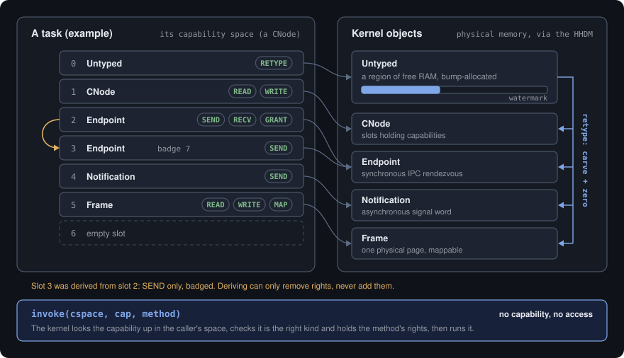

# Capabilities

> Status: **the model is implemented in milestone M3**, and M4 added
> blocking IPC and the ring-3 `syscall` entry. The capability data model,
> Untyped/retype, the object types, the invocation API, IPC and user tasks are
> in the kernel; Notification wait, Untyped splitting, revoke and user-made
> `Thread`/`AddressSpace` objects are M5 work (#162, #156). See the [security model](security-model.md) for the *why* and
> [ADR 0006](../adr/0006-security-model.md) / [ADR 0016](../adr/0016-capability-implementation.md)
> for the decisions.

Authority in this kernel is exactly the set of capabilities a task holds - no
ambient authority, no "root". A capability is an unforgeable reference to a
kernel object plus the rights over it; it can only be **attenuated** when
derived, never widened. This page describes how that model is built.

As throughout the kernel, the pure algebra lives in a `#![forbid(unsafe_code)]`,
host-tested crate (`capability`), and the parts that touch physical memory live
in `hal`.

<p align="center">
  
</p>

## Rights and capabilities

`Rights` is a set of bit flags (`READ`, `WRITE`, `EXECUTE`, `MAP`, `SEND`,
`RECV`, `GRANT`, `RETYPE`). A `Capability<Obj>` is an object handle plus its
rights and an optional **badge** (an identifier an endpoint's receiver sees).

- `derive(want)` yields a weaker capability holding exactly `want` - only if
  `want` is a subset of the current rights (attenuation; never widening).
- `mint(want, badge)` derives and stamps a badge once.

The kernel instantiates `Capability<ObjectRef>`, where `ObjectRef { kind, phys }`
is a **tagged physical reference**: the object's kind plus the physical address
of its storage. Mutable object state lives in that storage (reached via the
HHDM), so copies of a capability share one object.

## Capability space

Each task's capabilities live in a **flat table** of slots; a `CapId` is an
index (O(1) lookup). A **CNode** is the object form of such a table: retyped
storage holding a `Slot` array, accessed via the HHDM
(`hal::object::cnode_cap_space`). That returns a `CNodeSpace`, the only
capability space over the storage while it lives: forming a second one, or
freeing the frames under it, panics. Every other `hal::object` accessor takes
an `ObjectRef` and checks its kind, so one kind of object is never used as
another. A growable, two-level space is composed
from CNode capabilities.

## The derivation tree

Every slot also records where its capability came from
([ADR 0020](../adr/0020-capability-derivation-and-revoke.md), #156). Each
occupied slot holds a link (previous and next entry, and a depth), and each
list of links is a pre-order walk of a derivation tree:

| How a capability is made | Its place in the tree |
|---|---|
| `copy`, `mint` | a child of the source capability |
| `UntypedRetype` | a child of the Untyped capability |
| IPC transfer (`GRANT`) | a child of the sender's capability |
| `move` | the same place, in a new slot |
| made by the kernel at boot | a root; every other capability to the same object derives from it |

The tree spans every CNode, so links name slots as `SlotRef`s (a CNode's
index in the kernel's **CNode registry**, `kernel/src/cspace.rs`, and a slot
index), never as pointers. The pure `capability::mdb` module does every
insert, delete and move over a `SlotStore`, which the registry implements; a
table on its own only reads and writes whole entries. `copy` and `mint` may
only attenuate, and a slot fills only when empty.

- **Delete** removes one capability. What was derived from it moves up to
  its parent and stays valid.
- **Revoke** (`CNodeRevoke`) deletes everything derived from a capability,
  deepest and last first, and keeps the capability itself. Revoking a minted,
  badged endpoint capability takes back exactly the copies made from it. One
  call makes at most 64 deletions and then fails with `Again`, leaving a
  valid tree for the next call to continue from.
- **The last capability.** When a delete leaves no other capability to the
  same object, the object is destroyed. For an Endpoint, every thread queued
  on it wakes with `Revoked`. Other kinds hold no kernel state to tear down
  yet; their memory comes back when the task is reaped.

A delete or revoke can wake threads, so it runs under the `IPC` lock and then
`CSPACES` (`ipc::with_caps`). A CNode leaves the registry only after every
capability in it is deleted. A task may retype a CNode from its Untyped
(up to 256 slots), and destroying one, when its last capability goes, empties
it the same way: what was last in it is destroyed in turn, in a loop rather
than by recursion ([ADR 0023](../adr/0023-user-threads-and-address-spaces.md)).

## Untyped memory and retype

Objects are created by **retyping Untyped memory** - the kernel never
heap-allocates objects on a task's behalf, so a task spends its own memory
budget and cannot exhaust kernel memory.

- `Untyped { base, size, watermark }` is a bump allocator over a physical
  region; `allocate(size, align, count)` carves naturally-aligned storage
  (checked for alignment, overflow, and exhaustion). Reclamation is
  whole-region only: a finished revoke of a region's **original**
  capability leaves nothing retyped from it alive, so the watermark goes back
  to the base and the whole region can be retyped again.
- **Reaping a task goes through revoke** (#105, #156). The kernel keeps the
  originals of a task's CNode and Untyped capabilities in a small keeper
  CNode of its own, and the task holds copies. Everything the task makes or
  hands out therefore descends from those originals, even after the task
  deletes its own copies. A reap revokes them (in bounded rounds, yielding
  between them), so a server the task granted an endpoint loses it, and a
  thread blocked on it wakes with `Revoked`; then it deletes the task's
  remaining capabilities and frees its memory. A final scan
  (`find_reference`) checks that nothing names the memory any more, and
  keeps it for ever if something does, which would be a kernel bug.
- **Splitting** (`UntypedSplit`, #162) carves a child Untyped of whole
  pages from a region, a separate budget a server can hand a client: what is
  retyped from the child comes out of its pages only. The child's control
  block heads its own storage (`Untyped::child`). Its capability is a child of
  the parent's, so revoking the parent takes the child and everything made
  from it, and revoking the child resets the child's watermark.
- `hal::object::retype` carves from an Untyped and **zeroes** the storage
  through the HHDM, so a retyped object never exposes prior contents.
- An Untyped capability points at a small `repr(C)` control block holding its
  `Untyped` state, so the watermark persists across invocations.

## Object kinds

| Kind | Represents | Storage | Status |
|---|---|---|---|
| `Untyped` | unused physical memory | control block + region | retype and split work |
| `CNode` | a capability-space node | `Slot` array | backs the cap space |
| `Frame` | a physical page | one page | create + identify |
| `Endpoint` | a synchronous IPC rendezvous | its blocked-thread queue | IPC works between kernel threads (#81); user mode in #82 |
| `Notification` | an async signal | signal word + waiters | signal and wait (`Recv`, [ADR 0022](../adr/0022-notification-wait.md)), also from ring 3 |
| `AddressSpace` | a page-table root | a PML4, and an ASID | retyped and mapped into by tasks ([ADR 0023](../adr/0023-user-threads-and-address-spaces.md)); boot tasks' spaces are built by the kernel's loader |
| `PageTable` | one page-table page below a root | one page | retyped and installed by tasks (ADR 0023) |
| `Thread` | a schedulable context | - | kernel-internal; a capability to create one is M5 (#162) |

Each kind's storage `(size, align)` comes from `ObjectKind::fixed_layout` (or
`cnode_bytes` for a CNode).

## Invocation

Everything a task does is **invoke a capability** with a typed `Method`:

```
invoke(cspace, invoked, method) -> Result<InvokeOk, InvokeError>
```

The kernel resolves the invoked capability in the cap space, **authorizes** it
(`Method::authorize`: the capability must be the method's target kind and hold
its required rights), then performs the effect. Methods implemented in M3:

- `CNodeCopy` / `CNodeMint` / `CNodeMove` / `CNodeDelete` - manage capabilities
  (attenuation enforced).
- `CNodeRevoke` - delete everything derived from a capability (M5, #156).
- `FrameIdentify` - return a frame's physical address.
- `UntypedRetype` - carve a fixed-size object and install its capability.
- `NotificationSignal` - OR bits into a notification's signal word.

`Method::authorize` and the `Method`/error types are pure and host-tested; the
kernel dispatcher adds the memory effects. The ring-3 `syscall` entry (#82)
decodes raw register arguments into a `Method` and calls this same path.

## What M4 added, and what moves to M5

Done in M4:

- **Blocking synchronous IPC** (#81, [ADR 0018](../adr/0018-synchronous-ipc.md)):
  Send, Recv, Call, Reply and ReplyRecv, badges, and one-capability transfer
  under `GRANT`. The engine is the pure, host-tested `ipc` crate.
- **The `syscall` boundary** (#82, [ADR 0019](../adr/0019-first-user-task.md)):
  ring-3 tasks invoke capabilities and use IPC; the root task runs confined to
  the capabilities it was given.

Moved to M5, tracked:

- User-created **`Thread`** objects (#162). Notification wait
  ([ADR 0022](../adr/0022-notification-wait.md)), Untyped splitting and
  user-built address spaces are done.
- **Revoke**: a capability derivation tree
  ([ADR 0020](../adr/0020-capability-derivation-and-revoke.md), #156), which
  must land before any `GRANT` path between tasks.

## Layering & testing

| Concern | Pure crate (`capability`, host-tested) | `hal` binding |
|---|---|---|
| Rights & attenuation | `Capability`, `Rights` | - |
| Capability space | `CapSpace`, `Slot`, `CapId` | `cnode_cap_space` (HHDM) |
| Derivation tree | `mdb` (`SlotStore`, `SlotRef`, `Link`) | the kernel's CNode registry |
| Untyped accounting | `Untyped`, `ObjectKind`, `ObjectRef` | `retype`, `load`/`store_untyped` |
| Invocation | `Method`, `authorize`, errors | kernel `invoke` + effects |
