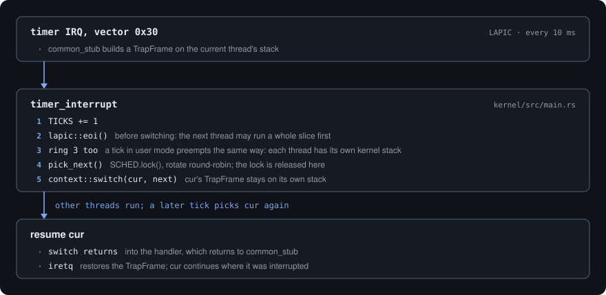

# Interrupts & Exceptions

> Status: **implemented** (M1, #10). Hand-rolled per
> [ADR 0009](../adr/0009-hand-rolled-cpu-tables.md). Hardware IRQ delivery via
> the Local APIC timer, driving preemptive scheduling, landed in M4 (#80); see
> [below](#hardware-irqs-the-local-apic-timer-and-preemption).

## Flow

  

## TrapFrame

`hal::idt::TrapFrame` (`#[repr(C)]`) mirrors the stack layout the stubs build:
the 15 general-purpose registers, then `vector` and `error_code`, then the
CPU-pushed frame (`rip`, `cs`, `rflags`, `rsp`, `ss`). Handlers receive
`&mut TrapFrame`, so they can both inspect and modify saved state (needed later
for scheduling and signal-like delivery).

## Error-code normalization

Vectors 8, 10, 11, 12, 13, 14, 17, and 21 push a CPU error code; the rest do
not. Each stub pushes a dummy `0` for the no-error-code vectors so every
`TrapFrame` has the same shape.

## Dispatch & registration

Dispatch is **table-driven**: a 256-entry table of handler function pointers
(`register_handler(vector, fn)`). This is the single hook for CPU exceptions,
hardware IRQs (M3), IPIs, and anything else. Vectors 0-31 are reserved by the
architecture for exceptions; 32-255 are available for IRQs and software use.

A vector with no registered handler falls back to `default_exception`, which
prints a diagnostic report (vector name, error code, `CR2` for page faults, and
a register dump) over serial. `#BP` (breakpoint) is a trap and resumes; any
other unhandled CPU exception is treated as unrecoverable and halts. (A richer
`#PF` handler and `panic!`-based reporting with a backtrace come with #11.)

## IST stacks

The IDT gates for the double fault (#DF → IST1), NMI (→ IST2), and machine
check (#MC → IST3) use the Interrupt Stack Table entries set up in
[`hal::gdt`](memory-layout.md), so these always execute on a known-good stack
even if the kernel stack is corrupt or overflowed.

## Vector map

| Vector(s) | Source | Handler |
|---|---|---|
| `0x00`-`0x1F` | CPU exceptions (architecturally reserved) | `default_exception` (+ `#PF` probe recovery) |
| `0x20`-`0x2F` | Legacy 8259 PICs, **remapped and fully masked** (`hal::pic`) | `0x27` / `0x2F`: spurious-IRQ sinks |
| `0x30` | **LAPIC timer** - periodic, 100 Hz | kernel `timer_interrupt` (tick + preempt) |
| `0xFF` | LAPIC spurious-interrupt vector (`hal::lapic`) | no-op, no EOI |

The PICs power up mapped onto `0x08`-`0x0F`, on top of CPU exceptions, so even
though nothing uses them they are reprogrammed out of the way and every line is
masked before interrupts are enabled; a masked PIC can still raise a spurious
IRQ7/IRQ15, which lands harmlessly on `0x27`/`0x2F`.

## Hardware IRQs: the Local APIC timer and preemption

Bring-up (`init_preemption` in `kmain`, after the ring-3 demo):

1. `hal::pic::disable()` - remap the 8259s to `0x20`-`0x2F` and mask them.
2. `hal::lapic::init(space, va)` - read `IA32_APIC_BASE`, map the xAPIC
   register page at a dedicated kernel VA (`0xffff_fe00_0000_0000`, PML4 slot
   508) **uncached + NX** (Intel SDM Vol. 3A §11.4.1), set the global and
   software enables, `TPR = 0`, spurious vector `0xFF`.
3. `hal::lapic::start_periodic(0x30, 100)` - **calibrate** the APIC timer
   against PIT channel 2 (a 10 ms one-shot, polled through port `0x61`, so no
   IRQ and no PIC is involved), then program it periodic at divide-by-16 with
   `initial count = ticks/ms × 10`.
4. `sti` on the boot thread. Fresh threads start with interrupts enabled (the
   `hal::context` `thread_start` trampoline).

Every timer interrupt runs the kernel's `timer_interrupt`:

  

Because the interrupted thread's full register state is already in its
`TrapFrame`, the ordinary callee-saved [context switch](../adr/0017-threads-and-scheduling.md)
is enough to preempt it: no separate "interrupt context" save path exists.

### Interrupt-safety rules (deadlock freedom)

Preemption makes the interrupt-safe `SpinLock` (#62) load-bearing. The rules
that keep the single-core kernel deadlock-free:

- **Every `SpinLock` holder runs with interrupts disabled.** A timer interrupt
  therefore never arrives while a lock is held on this core, so the timer
  handler's `SCHED.lock()` (and anything else it might take) cannot spin on a
  lock its own interrupted thread holds.
- **No context switch while holding a lock.** `pick_next` drops the scheduler
  guard before the switch; the guard does not re-enable interrupts because the
  caller had already disabled them.
- **Pick-to-switch is atomic w.r.t. the timer.** `yield_now` and
  `exit_current` disable interrupts across choosing the next thread *and*
  switching to it (`hal::cpu::without_interrupts`); otherwise a tick in between
  would rotate the queue again and the switch would act on stale state.
  `hal::context::switch` documents this precondition.
- **Each thread restores its own interrupt flag.** Switches always happen with
  `IF = 0`. A thread resumed in `yield_now` restores its saved flag on the way
  out of `without_interrupts`; a preempted thread gets its `RFLAGS` back from
  `iretq`; a fresh thread executes `sti` in `thread_start`.
- **The timer handler never logs or allocates**, and EOIs before switching.
- The panic handler (which first disables interrupts) and `default_exception`
  write to a fresh serial port rather than the logger, so a fault while a lock
  is held still reports.

Verified in QEMU with two kernel threads that never yield: both make
interleaved progress, and a stress variant (1 kHz timer; both threads
allocating, using the frame allocator and logging in a tight loop) ran ~6000
preemptions with no deadlock.

### Ring 3: per-thread kernel stacks and fault containment (#82)

Every user thread has its own 16 KiB kernel stack, above an unmapped guard
page ([ADR 0019](../adr/0019-first-user-task.md)). `thread::switch_to`, the one
path every context switch takes, points `TSS.rsp0` and the syscall entry at the
next thread's kernel stack and loads its address space, so:

- **Ring 3 is preempted like kernel code.** A tick in user mode enters on that
  thread's own kernel stack; its `TrapFrame` stays there while others run.
- **A thread can block inside a syscall.** The syscall stub keeps the user
  `rsp` on the thread's kernel stack, not in a global across the call. The stub
  itself runs with `IF = 0` (`FMASK`).
- **A CPU exception raised in ring 3 ends that thread, never the kernel.**
  `idt_dispatch` routes vectors 0 to 31 whose trap frame has `CS & 3 == 3` to the
  kernel's user-fault handler, which logs the fault and exits the thread (waking
  any caller waiting on it for a reply, with `PeerExited`). It keys on the trap
  frame, never on which thread is current, so a fault in ring 0 stays fatal.

### Limits (future work)

- Single core only: one LAPIC, one run queue, no IPIs. SMP needs per-CPU state.
- xAPIC (MMIO) mode only; x2APIC is a later refinement. No I/O APIC yet -
  device IRQs arrive with driver servers (M5/M6).
- The timer is a fixed-rate tick, not tickless/one-shot.
