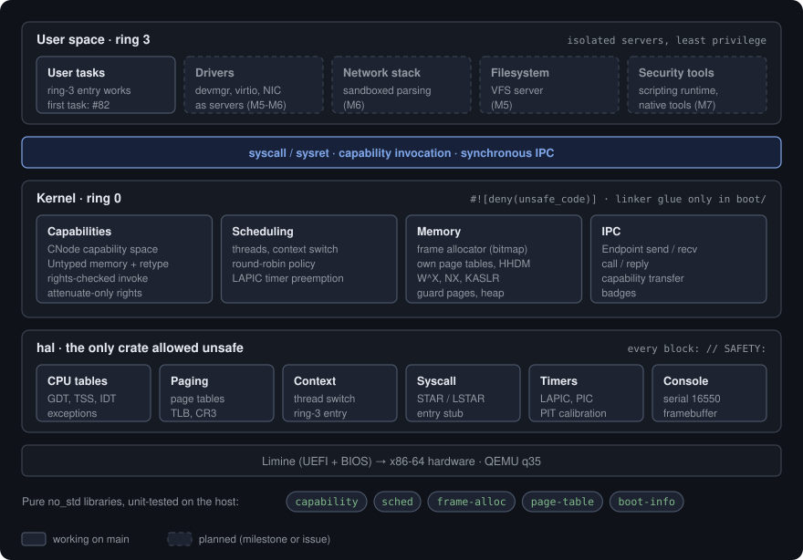

# Architecture Overview

> Status: **design**. Describes the intended architecture; sections are updated
> as subsystems land.

## Kernel model: microkernel

The privileged kernel (ring 0) is deliberately **tiny**. It provides only:

- **address spaces** and physical memory management,
- **threads and scheduling**,
- **capabilities** - unforgeable handles that name every resource,
- **IPC** - synchronous message passing, including capability transfer.

Everything else - device drivers, the network stack, filesystems, the security
tooling runtime - runs in **user space as isolated servers**, each with only
the capabilities it was granted. A compromised driver or a bug in a packet
parser is confined to that server and cannot escalate to kernel privilege.
See [ADR 0004](../adr/0004-kernel-architecture.md).

This is the opposite of a monolithic kernel (Linux, the BSDs) and is chosen
specifically for the security goal: the **Trusted Computing Base (TCB)** - the
code that must be correct for the system to be secure - is as small as we can
make it, and it is written in safe Rust.

  

Solid boxes run on `main` today; dashed boxes are planned, labelled with their
milestone or issue.

## Language and the unsafe boundary

The whole system is **Rust, `no_std`**. Pure-logic crates (`libs/*`, and the
user-space servers and tools) compile with `#![forbid(unsafe_code)]`. The
`kernel` binary uses `#![deny(unsafe_code)]`; its only `unsafe` is confined to
the `boot` module (`kernel/src/boot/`, CI-enforced), which holds the ELF entry
point and the Limine request statics - linker glue needing the
`#[unsafe(no_mangle)]`/`#[unsafe(link_section)]` attributes, not memory-unsafe
code. Kernel logic (`kmain` and below) stays `unsafe`-free. Raw hardware access
(reading MSRs, touching MMIO, writing page tables, inline assembly) lives
**only** in the `hal` crate, where every `unsafe` block carries a `// SAFETY:`
comment stating the invariant it relies on. This concentrates the auditable,
dangerous code into two small, reviewed places (`hal` and the kernel `boot`
module). See [ADR 0001](../adr/0001-implementation-language.md) and
[ADR 0007](../adr/0007-unsafe-policy.md).

## Security model: capabilities

There is **no ambient authority**. A task can do nothing except invoke the
capabilities in its capability space. Opening a device, mapping memory, sending
a packet - each requires holding a capability that grants exactly that right.
Capabilities are transferred explicitly over IPC, so privilege flows are
visible and auditable. Details in [security-model.md](security-model.md) and
[ADR 0006](../adr/0006-security-model.md).

## The offensive side

Security *tooling* is a first-class workload. The kernel exposes low-level
primitives (raw packet TX/RX, promiscuous mode) as capabilities, and a
user-space **scripting runtime** lets you write and run tools - scanners,
sniffers, fuzzers - without rebuilding the kernel. The runtime itself holds only
the capabilities it is granted, so "offense" is contained like any other
server. See [ADR 0008](../adr/0008-native-tooling.md).

## Subsystems

| Subsystem | Location | Milestone | Responsibility |
|---|---|---|---|
| Hardware abstraction | `hal/` | M0-M1 | CPU tables, MMIO, paging, asm - the only `unsafe` |
| Boot handoff | `kernel/src/boot` | M0 | Receive control from Limine, build `BootInfo` |
| Early console | `hal` serial | M0 | 16550 UART for logging |
| Memory | `kernel/src/mem` | M2 | Frames, address spaces, W^X, KASLR |
| Capabilities | `kernel/src/cap` | M3 | Object model, rights, derivation |
| IPC | `kernel/src/ipc` | M3 | Synchronous message + capability transfer |
| Scheduler | `kernel/src/sched` | M4 | Threads, preemption |
| Syscall boundary | `kernel/src/syscall` | M3-M4 | The thin user↔kernel interface |
| User servers | `servers/` | M5-M6 | Drivers, net, fs - isolated, least privilege |
| Security runtime | `runtime/` | M7 | Scripting engine for native tooling |
| Native tools | `tools/` | M7 | Scanner, sniffer, fuzzer, ... |

## Cross-cutting principles

- **Minimal TCB.** Anything that can live in user space, does.
- **No ambient authority.** If code needs a right, it must hold a capability.
- **Unsafe is quarantined.** Only `hal`, only with documented invariants.
- **Fail closed, fail loud.** `panic!` in the kernel over continuing corrupt;
  servers that fault are restarted, not trusted.
- **Everything parsed is hostile.** Parsers (packets, filesystems, images) run
  in sandboxed servers and are fuzzed.
